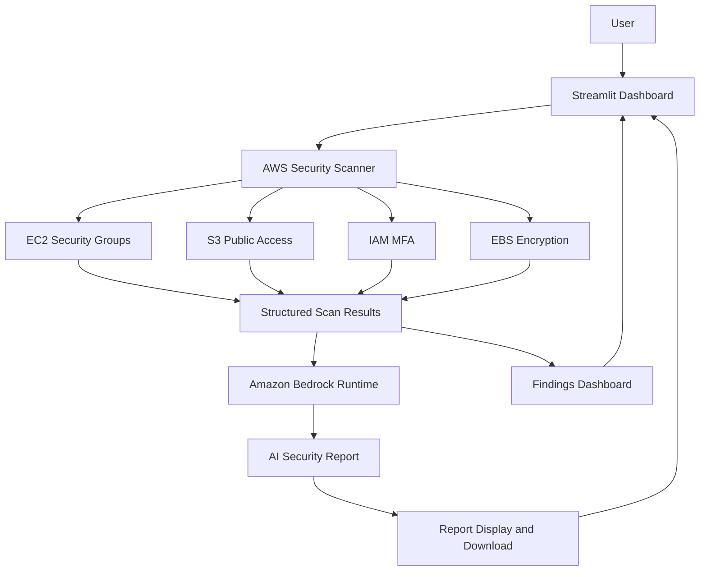

# 🛡️ AWS Cloud Security Sentinel

A read-only AWS security scanner built with **Python, Boto3, Amazon Bedrock, and Streamlit** to identify common cloud security risks and generate an AI-assisted security report.

## 🚀 Features

- **Network Security:** Detects Security Groups exposing SSH (22), RDP (3389), or all ports to the public internet.
- **S3 Public Access:** Checks bucket-level Block Public Access settings, bucket policy public-access status, and broad ACL grants.
- **IAM MFA:** Identifies IAM users without registered MFA devices.
- **EBS Encryption:** Detects unencrypted EBS volumes in the selected AWS Region.
- **AI Security Report:** Uses Amazon Bedrock to summarize findings and recommend remediation steps.
- **Interactive Dashboard:** Displays audit results, status indicators, findings, and downloadable reports through Streamlit.
- **Error Handling:** Distinguishes PASS, FAIL, WARNING, and ERROR states.
- **Mocked Tests:** Tests security detection logic and selected error scenarios without changing real AWS resources.

## 🧰 Tech Stack

- Python
- Boto3
- Amazon EC2, S3, IAM, and EBS
- Amazon Bedrock Runtime
- Streamlit
- Pandas
- AWS CLI

## 📁 Project Structure

```text
aws-cloud-security-sentinel/
├── aws_security_scanner.py
├── ai_reporter.py
├── app.py
├── test_security_scanner.py
├── test_ai_reporter.py
├── requirements.txt
├── README.md
└── .gitignore
```

## 🏗️ Architecture



## ⚙️ Prerequisites

- Python 3.11 or newer
- AWS CLI v2
- An AWS account with the required read-only permissions
- Access to a supported Amazon Bedrock model or inference profile
- Network connectivity to AWS APIs

## 🔧 Installation

### 1. Clone the repository

```bash
git clone https://github.com/sujal-07-Ronny/aws-cloud-security-sentinel.git
cd aws-cloud-security-sentinel
```

### 2. Create and activate a virtual environment

**Windows CMD:**

```cmd
python -m venv .venv
.venv\Scripts\activate.bat
```

### 3. Install dependencies

```bash
python -m pip install -r requirements.txt
```

### 4. Configure AWS credentials

Use an approved AWS credential method, such as AWS CLI profiles or IAM Identity Center.

Verify authentication:

```bash
aws sts get-caller-identity
```

Check the configured Region:

```bash
aws configure get region
```

Never hardcode AWS credentials or commit secret keys to GitHub.

## ▶️ Usage

### Run the security scanner

```bash
python -c "from aws_security_scanner import run_security_scan; import json; print(json.dumps(run_security_scan(region='ap-south-1'), indent=2))"
```

The scanner returns structured JSON containing check statuses, findings, remediation recommendations, and errors.

### Launch the Streamlit dashboard

```bash
python -m streamlit run app.py
```

Open the local URL shown in the terminal, usually `http://localhost:8501`.

Select the AWS Region and click **Run Security Audit** to scan resources and generate the AI report.

## 🧪 Testing

Check Python syntax:

```bash
python -m py_compile aws_security_scanner.py ai_reporter.py app.py
```

Run the mocked test suites:

```bash
python -m unittest -v test_security_scanner test_ai_reporter
```

Tests cover public SSH exposure, S3 configuration, missing IAM MFA, unencrypted EBS volumes, permission errors, and mocked Bedrock responses.

Mocked tests do not modify real AWS resources. A successful test suite does not guarantee that every possible AWS security issue is detected.

## 🔐 Security Design

- Uses AWS SDK credentials instead of hardcoded secrets.
- Performs read-only security inspection.
- Does not automatically modify AWS resources.
- Does not execute AI-generated commands.
- Reports errors when checks cannot complete.
- Provides findings for human review before remediation.

## ⚠️ Limitations

- Network checks inspect selected inbound Security Group rules, not every possible network path.
- S3 checks inspect selected bucket-level public-access settings, bucket policy status, and ACL grants. They do not prove that every object or access path is private.
- IAM MFA checks inspect IAM users and do not assess every federated identity or access method.
- EBS checks cover the selected Region, not necessarily every Region in the account.
- AI-generated explanations and recommendations may be inaccurate and require human review.
- A PASS status means only that the implemented check did not detect a matching issue.

## 💰 Cost Considerations

The dashboard runs locally and does not require paid hosting.

Amazon Bedrock inference may incur charges. Existing EC2 instances, EBS volumes, load balancers, and other AWS resources can also incur charges independently of this project.

Review current AWS pricing before running paid services.

## 🧹 Cleanup

- Stop the local dashboard with `Ctrl+C`.
- Stop or delete only AWS resources created for experimentation that are no longer needed.
- Review EC2 instances, EBS volumes, snapshots, load balancers, and other potentially billable resources.
- Do not delete resources without checking their ownership and dependencies.

The scanner itself does not create or delete AWS resources.

## 💼 Resume Project Description

**AWS Cloud Security Sentinel | Python, Boto3, Amazon Bedrock, Streamlit**

- Developed a read-only AWS security scanner to identify public Security Group exposure, S3 public-access configuration concerns, IAM users without MFA, and unencrypted EBS volumes.
- Integrated Amazon Bedrock to generate AI-assisted security summaries and remediation recommendations from structured scan results.
- Built a Streamlit dashboard for security findings, check statuses, errors, and downloadable reports.
- Implemented pagination, exception handling, and mocked tests for detection logic and selected failure scenarios.

---

**Author:** [Sujal Shaha](https://github.com/sujal-07-Ronny)

**Repository:** [AWS Cloud Security Sentinel](https://github.com/sujal-07-Ronny/aws-cloud-security-sentinel)
